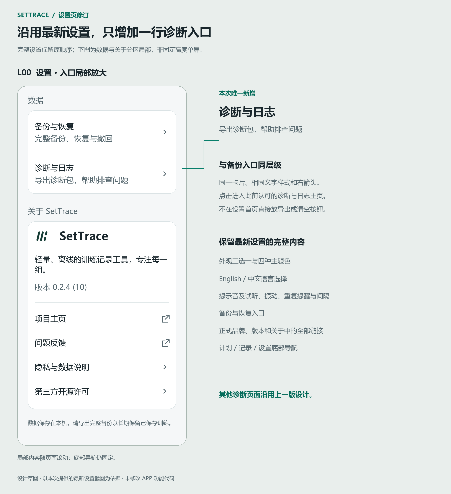
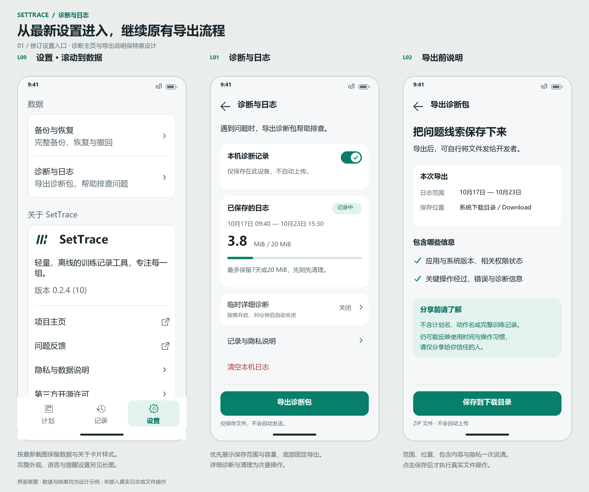
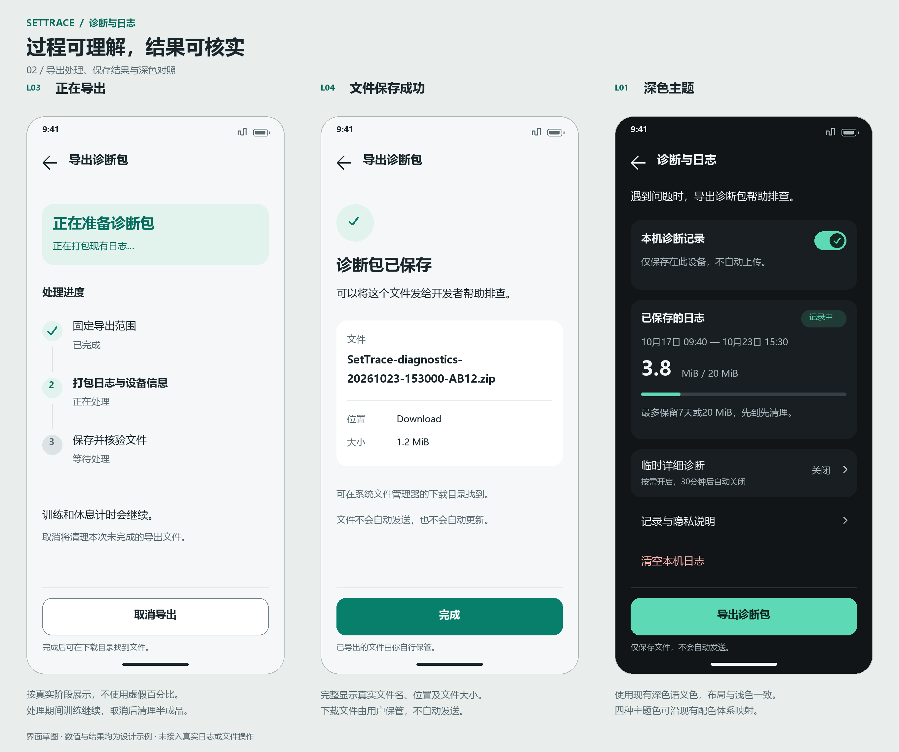
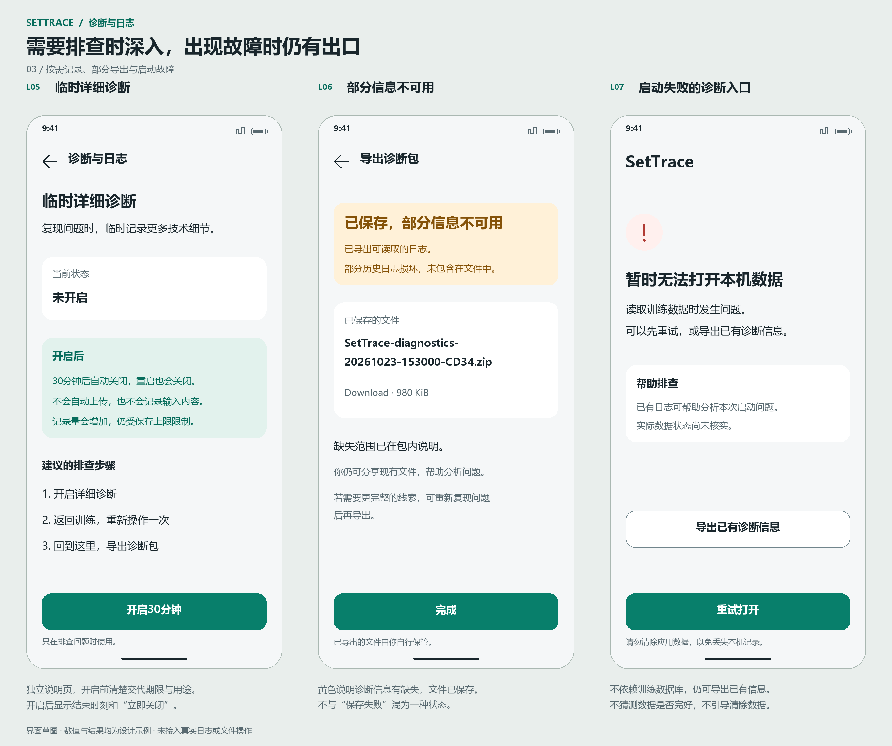

# 诊断与日志 UI 设计

版本 `diagnostics-ui-2026-10-23` · 实施更新2026-10-24 · **UI已实现，设备验收仍有待验范围**。基于 SetTrace `focus-a-2026-10-14`、现有四主题色、最新完整设置界面及此前讨论的本地日志方案。

本设计已接入[主设计入口](../README.md)、主规范 §14、页面清单、INT-13 和 LOGUI-01–12。开发从[UI规范](ui-spec.md)与[实现对接说明](implementation-handoff.md)读取完整依据；本次按 `add-local-diagnostics` 实施Flutter与Android能力，真实截图、自动化结果及待验范围见[实施验收](../../qa/local-diagnostics-acceptance.md)。原PNG/SVG保留为已确认设计。

| 资料 | 用途 |
| --- | --- |
| [UI 规范](ui-spec.md) | 已确认布局、页面状态、导航、失败恢复、隐私、双语与适配 |
| [实现对接说明](implementation-handoff.md) | 现有代码对接点、UI 所需状态、平台结果边界与技术设计输入 |
| [主规范](../SetTrace_UI_Design_System_and_Flutter_Spec.md) | 共享语义颜色、组件、字号、尺寸和 §14 增量 |
| [页面清单](../screens-and-states.md)／[交互](../interaction-spec.md)／[验收](../acceptance-checklist.md) | L/LD/LE、INT-13、LOGUI-01–12 的统一索引 |

## 最新设置页修订

依据用户本次提供的完整设置长截图重新绘制。保留外观三选一、四主题色、双语选项、全部休息提醒子项和说明、备份入口、正式品牌、关于全部链接及一级导航，仅在数据卡片中增加与备份同级的“诊断与日志”。上一稿简化设置片段不再作为设置页依据。

- [最新设置完整滚动长图](00-settings-latest-full.png) / [可编辑矢量](00-settings-latest-full.svg)
- [数据入口与关于分区局部放大](00-settings-latest-focus.png) / [可编辑矢量](00-settings-latest-focus.svg)
- [修订后的主要流程](01-main-flow.png)



已认可的诊断主页和导出说明画面逐像素核对保持一致；导出过程、结果、深色和辅助故障两组PNG/SVG均通过SHA-256核对未改变。详见 `settings-revision-checks.json`。参考截图只读查看，没有修改原图；正式品牌复用项目现有资产。

- [主要流程：设置入口、日志主页、导出说明](01-main-flow.png)
- [导出过程、保存结果与深色对照](02-export-and-dark.png)
- [临时详细诊断、部分导出与启动故障](03-support-states.png)
- [完整 UI 与交互说明](ui-spec.md)
- [后续程序设计与实现对接](implementation-handoff.md)
- 可编辑矢量：[主要流程](01-main-flow.svg)、[结果与深色](02-export-and-dark.svg)、[故障状态](03-support-states.svg)







## 设计与验证边界

原有三张画板、九个手机画面，另新增设置完整滚动长图和局部说明图；390×844 为流程画板中的布局说明尺寸，长图不代表固定高度单屏，PNG 按 2 倍绘制。实际界面以设备约束和系统字号适配，长图中的底部导航仅在末尾展示一次，运行时仍固定在屏幕底部。时间、版本、容量、文件名与成功结果均为示例，不能作为功能实现或平台运行证据。

设计阶段的文字、卡片、底栏及浅深检查见 `sketch-checks.json` 和 `settings-revision-checks.json`；这些历史记录仍只证明草图。本次新增Flutter矩阵与API36实际运行、Download导出证据，分开记录于实施验收；TalkBack和其他API不得由这些结果代替。流程画板的设置入口是滚动到数据后的单屏片段，完整设置以最新长图为准；不据片段删除或改造未出现在该屏的控件。

使用 `ui-ux-pro-max` 进行了设计系统检索、错误恢复与进度反馈检索、Flutter 辅助技术检索。两次设计系统检索均给出偏网站的 Hero 布局，没有找到适合该设置功能的完整布局匹配，因此未保存或采用其通用配色、字体和布局。实际视觉来源为项目现行规范；只采用适用的单主操作、明确错误恢复、渐进披露、触控与语义指导。

绘图脚本使用预装 Pillow 和 Windows 字体，不安装或下载依赖；字体仅用于草图，不为 APP 新增字体。重新生成应在项目根目录运行，使用有 Pillow 的 Python：

```powershell
python -B docs/design/diagnostics/render_sketches.py
```

脚本只向自身目录输出三组 PNG/SVG 和宽度检查 JSON。

重新生成本次设置修订（完整长图、局部说明、主要流程设置片段及保持性核查）：

```powershell
python -B docs/design/diagnostics/render_settings_revision.py
```

以上命令均需要已有Pillow环境。技能检索对本次设置导航没有提供直接适配的完整界面建议，因此以用户最新截图和项目现行规范为准，不因检索推荐改变导航方案。

文档同步核查见 [documentation-checks.json](documentation-checks.json)。该文件记录链接、编号和设计资源保持检查，不是功能实现或真机验收报告。
